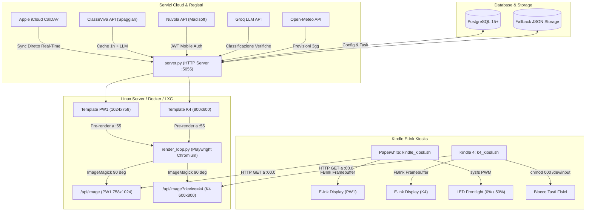

# Kindle Calendar Dashboard (E-Ink Smart Kiosk)

[](LICENSE)
[](#)
[](#)
[](#)
[](#)

Architettura e suite software production-ready open source per trasformare dispositivi **Amazon Kindle con jailbreak** in smart display da scrivania a bassissimo consumo energetico, alto contrasto e aggiornamento atomico al minuto (:00.0).

Supporta nativamente una configurazione **multi-device parallela**:
1. **Kindle Paperwhite (PW1 / PW2 / PW3 / PW4)** — Display 1024x758, sincronizzazione Apple iCloud CalDAV, agenda scolastica **ClasseViva**, previsioni meteo e controllo hardware frontlight.
2. **Kindle 4 (K4 Non-Touch)** — Display 800x600, sincronizzazione **Nuvola Registro Elettronico (Madisoft)** tramite API mobile native, blocco hardware dei tasti fisici e layout dinamico a 4 fasi giornaliere.

---


> Consulta la [Guida Completa agli Scenari e Stati della Dashboard](docs/scenari_dashboard.md) per visionare gli screenshot di tutti i comportamenti (mattina, scuola, pomeriggio post-scuola, sera, weekend e vacanze).

---

## Architettura di Sistema



---

## Specifiche Tecniche e Funzionalita

### Sincronizzazione Calendario CalDAV Real-Time (Zero Mac)
- **Nessuna dipendenza da computer locali:** Il server Linux interroga direttamente i server Apple (`caldav.icloud.com`) tramite autenticazione CalDAV standard.
- **Aggiornamento Immediato:** Non appena un evento viene creato o modificato da iPhone, iPad, Apple Watch o Mac, viene salvato su iCloud e rilevato dal demone di sincronizzazione in background del server entro il minuto successivo.
- **Cache Resiliente su Disco:** In caso di interruzioni di rete temporanee, il server mantiene l'ultimo snapshot valido senza mai mostrare viste vuote.
- **Endpoint di Refresh Manuale:** E possibile forzare un aggiornamento immediato tramite `POST /api/calendar/refresh`.

### Sincronizzazione Atomica (:00)
- Il motore di rendering Playwright Chromium e mantenuto residente in memoria RAM per azzerare i tempi di cold-start.
- Lo snapshot per il minuto successivo viene elaborato a **`:55`** del minuto corrente ed etichettato con il timestamp target.
- L'immagine ruotata a 90 gradi viene salvata su disco tramite operazione atomica POSIX (`rename`).
- Il demone client del Kindle si risveglia a **`:00.0`**, effettua il download in ~50ms e disegna sul framebuffer via FBInk in ~250ms, completando l'aggiornamento visivo entro i primi 300 millisecondi del minuto solare.

### Classificazione Semantica Verifiche (Groq LLM)
- I dati estratti dall'agenda scolastica vengono elaborati tramite il modello di inferenza veloce `qwen/qwen3.8-27b` su Groq.
- L'analisi contestuale previene i falsi positivi (ad esempio formulazioni come *"rispondere sul quaderno, tipo verifica di storia alle domande..."* vengono correttamente identificate come compiti ed escluse dalle verifiche).
- Le verifiche reali vengono evidenziate visivamente con inversione cromatica ad alto contrasto.

### Controllo Hardware Frontlight Notturno
- Il framework standard di Amazon non disattiva completamente i LED frontlight quando impostato a livello zero via interfaccia utente.
- Lo script kiosk interagisce direttamente con il controller PWM del kernel Linux (`/sys/devices/system/fl_tps6116x/fl_tps6116x0/fl_intensity`), garantendo lo spegnimento fisico completo durante la fascia notturna (22:00 - 06:30).
- Alle 06:30 il controller ripristina la luminosita al 50% (livello 12 di 24).

### Transizione Intelligente del Layout e Routine Giornaliera
- **Fascia Mattutina (06:30 - 08:00):** Orario delle lezioni a sinistra e checklist zaino a destra per la preparazione prima di uscire.
- **Orario Scolastico (08:00 fino a termine lezioni + 30 min):** Visualizzazione lezioni del giorno con evidenziazione in tempo reale della materia in corso; meteo locale e compiti a destra.
- **Pomeriggio (dopo 30 min dal termine lezioni - 21:30):** Transizione automatica alla linea del tempo della giornata (07:00 - 23:00 con impegni di calendario e indicatore orario live) sulla sinistra, mantenendo il meteo e i compiti sulla destra.
- **Fascia Serale/Notturna (21:30 - 06:30):** Se l'indomani e un giorno di scuola effettivo, proiezione orario scolastico del giorno successivo a sinistra e checklist per la preparazione dello zaino a destra.

### Calendario Scolastico Ufficiale e Gestione Vacanze (`holiday`)
- **Anno Scolastico (Regione Veneto DGR n. 239/2026 e 712/2026):** Inizio lezioni il **10 settembre 2026**, termine lezioni l'**8 giugno 2027**.
- **Giorni di Lezione Ordinari:** Dal Lunedi al Sabato all'interno del calendario scolastico (esclusi ponti e vacanze).
- **Vacanze Scolastiche Ufficiali (categorizzate come `holiday`):**
  - **Vacanze Estive:** Antecedenti al 10 settembre 2026 e successive all'8 giugno 2027 (`holiday_type: "summer"`).
  - **Vacanze Natalizie / Invernali:** 24 dicembre 2026 - 6 gennaio 2027 (`holiday_type: "winter"`).
  - **Vacanze di Carnevale:** 8 - 10 febbraio 2027 (`holiday_type: "carnival"`).
  - **Vacanze Pasquali:** 25 - 30 marzo 2027 (`holiday_type: "easter"`).
  - Durante questi periodi, la dashboard passa automaticamente alla vista libera (linea del tempo + meteo + impegni personali come la domenica), con il badge dedicato `Vacanze • <Nome Vacanza>`.
- **Ponti e Festivita Singole (categorizzati come `bridge`):** Ponte dell'Immacolata (7 dic), Immacolata (8 dic), Liberazione (25 apr), Ponte 1 Maggio (29-30 apr), Festa Repubblica (2 giu).

---


## Installazione e Configurazione

### Metodo A: Docker Compose (Consigliato per Server / NAS / Raspberry Pi)

Il modo più rapido per avviare l'intero stack (server dashboard + database PostgreSQL):

```bash
git clone https://github.com/Gianlu1107/kindle-calendar.git
cd kindle-calendar

# Configura le tue credenziali
cp .env.example .env
nano .env

# Avvia lo stack
docker compose up -d
```

La dashboard sarà immediatamente disponibile su `http://<IP_SERVER>:5055/`.

---

### Metodo B: Installazione Nativa (Debian / Ubuntu / Proxmox LXC)

Esegui lo script di configurazione automatica per installare dipendenze di sistema, virtualenv Python, browser Playwright e servizi systemd:

```bash
git clone https://github.com/Gianlu1107/kindle-calendar.git /opt/kindleCalendar
cd /opt/kindleCalendar
sudo ./setup.sh
```

Oppure manualmente:
```bash
sudo apt update && sudo apt install -y python3 python3-venv imagemagick curl git postgresql postgresql-contrib libpq-dev

python3 -m venv venv
./venv/bin/pip install --upgrade pip
./venv/bin/pip install -r requirements.txt
./venv/bin/playwright install chromium
./venv/bin/playwright install-deps chromium

cp .env.example .env
nano .env

# Avvio servizi
sudo cp systemd/kindle-server.service /etc/systemd/system/
sudo cp systemd/kindle-renderer.service /etc/systemd/system/
sudo systemctl daemon-reload
sudo systemctl enable --now kindle-server.service kindle-renderer.service
```

---

### 3. Setup dei Dispositivi Kindle (Client Kiosk)

#### Prerequisiti per entrambi i dispositivi:
1. Jailbreak attivo sul Kindle (JB per PW o K4).
2. KUAL installato (per la gestione pacchetti).
3. Estensione **USBNetwork** installata con demone SSH attivo su rete Wi-Fi.
4. Utility **FBInk** presente in `/mnt/us/usbnet/bin/fbink`.

---

#### A. Setup Kindle Paperwhite (PW1 / PW2 / PW3 / PW4)
Copia lo script kiosk e la configurazione sul Kindle via SCP:
```bash
# Copia script e config
scp client/kindle_kiosk.sh root@<IP_KINDLE>:/mnt/us/kindle_kiosk.sh
scp client/kindle_kiosk.env.example root@<IP_KINDLE>:/mnt/us/kindle_kiosk.env
ssh root@<IP_KINDLE> "chmod +x /mnt/us/kindle_kiosk.sh"

# Modifica l'IP del server nel file di configurazione
ssh root@<IP_KINDLE> "nano /mnt/us/kindle_kiosk.env"

# Registra il demone Upstart per l'avvio automatico al boot
scp client/kindle_kiosk.conf root@<IP_KINDLE>:/etc/upstart/kindle_kiosk.conf
ssh root@<IP_KINDLE> "/sbin/restart kindle_kiosk"
```

---

#### B. Setup Kindle 4 (K4 Non-Touch)
Il Kindle 4 utilizza un framebuffer 600x800 e riceve lo snapshot dedicato con layout adattato per K4:
```bash
# Copia script e config
scp client/k4_kiosk.sh root@<IP_K4>:/mnt/us/k4_kiosk.sh
scp client/kindle_kiosk.env.example root@<IP_K4>:/mnt/us/kindle_kiosk.env
ssh root@<IP_K4> "chmod +x /mnt/us/k4_kiosk.sh"

# Modifica SERVER_BASE con il proprio IP server
ssh root@<IP_K4> "nano /mnt/us/kindle_kiosk.env"

# Avvio del demone kiosk in background
ssh root@<IP_K4> "/mnt/us/k4_kiosk.sh >/dev/null 2>&1 &"
```

---

### 4. Sincronizzazione macOS Calendar (Opzionale)

Se preferisci esportare localmente da Calendar.app su Mac verso il server Linux senza CalDAV diretto:
1. Configura `macos_sync/sync_calendar.py` (o imposta la variabile d'ambiente `KINDLE_SERVER_HOST`).
2. Registra il job in launchd:
```bash
cp macos_sync/com.kindle.calendarsync.plist.example ~/Library/LaunchAgents/com.kindle.calendarsync.plist
launchctl load ~/Library/LaunchAgents/com.kindle.calendarsync.plist
```

---

## Configurazione Variabili d'Ambiente (`.env`)

| Parametro | Descrizione | Default / Note |
|---|---|---|
| `PORT` | Porta di ascolto del web server locale | `5055` |
| `DATABASE_URL` | URL connessione database PostgreSQL | `postgresql://...` |
| `CITY` | Città per il meteo Open-Meteo | `Padova` |
| `ICLOUD_APPLE_ID` | Apple ID iCloud per CalDAV real-time | Opzionale |
| `ICLOUD_APP_PASSWORD` | Password per app generata su appleid.apple.com | Opzionale |
| `CLASSEVIVA_USERNAME` | Username ClasseViva (Spaggiari) | Opzionale |
| `CLASSEVIVA_PASSWORD` | Password ClasseViva (Spaggiari) | Opzionale |
| `NUVOLA_USERNAME` | Username Nuvola Registro Elettronico | Opzionale |
| `NUVOLA_PASSWORD` | Password Nuvola Registro Elettronico | Opzionale |
| `GROQ_API_KEY` | Chiave API per classificazione semantica verifiche | Opzionale |
| `K4_IP` | Indirizzo IP del Kindle 4 per routing automatico | Opzionale |

---

## Testing e Sviluppo

Il repository include una suite completa di test unitari con mock per la validazione di tutti i comportamenti e gli scenari temporali:

```bash
# Esecuzione test unitari
python3 -m unittest discover tests -v
```

Per simulare e visualizzare nel browser un determinato scenario o orario:
- `http://localhost:5055/?day=lunedi&time=07:30` (Preparazione zaino mattina)
- `http://localhost:5055/?day=lunedi&time=10:15` (Durante le lezioni)
- `http://localhost:5055/?day=lunedi&time=14:30` (Linea del tempo pomeridiana)
- `http://localhost:5055/?day=lunedi&time=21:45` (Controllo zaino per domani)
- `http://localhost:5055/k4?phase=morning_prep` (Vista Kindle 4 mattina)
- `http://localhost:5055/k4?phase=school_progress` (Vista Kindle 4 scuola live)

---

## Licenza

Distribuito sotto licenza [MIT](LICENSE). Libero per uso personale e commerciale.
