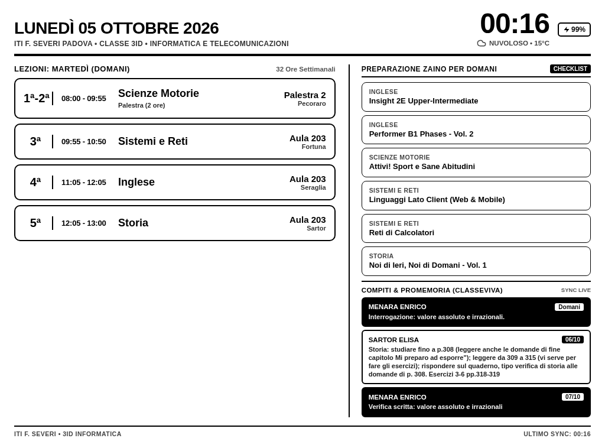

# Kindle Calendar Dashboard (E-Ink Smart Kiosk)

[](LICENSE)
[](#)
[](#)
[](#)

Architettura e suite software per trasformare un **Amazon Kindle Paperwhite (PW1 / PW2 / PW3 / PW4)** con jailbreak in uno smart display da scrivania a basso consumo energetico e ad alto contrasto.

Il sistema aggrega e visualizza in tempo reale:
- **Linea temporale giornaliera (07:00 - 23:00):** layout proporzionale con orologio atomico e indicatore di avanzamento sincronizzati al minuto esatto.
- **Integrazione Apple Calendar e iCloud:** sincronizzazione bidirezionale, deduplicazione intelligente degli eventi, gestione eventi per l'intera giornata e impegni a orario.
- **Registro Elettronico Scolastico (ClasseViva Spaggiari):** estrazione automatica di compiti e verifiche con analisi semantica via **Groq LLM** per la classificazione puntuale tra prove di verifica e compiti ordinari.
- **Previsioni Meteorologiche Locali:** integrazione con Open-Meteo API per previsioni a 3 giorni con icone vettoriali SVG monocromatiche native.
- **Monitoraggio Batteria e Stato Alimentazione:** lettura diretta dai registri hardware del controller di carica del dispositivo.
- **Gestione Hardware della Luminosita (PWM Shutdown):** spegnimento fisico dei LED frontlight (0%) tra le **22:00** e le **06:30**, con riaccensione al 50% alle **06:30**.

---



---

## Architettura di Sistema

```mermaid
flowchart TD
    subgraph Client ["macOS Client"]
        A[Apple Calendar.app] -->|AppleScript| B[sync_calendar.py]
        B -->|SCP / rsync| C[calendar_feed.ics]
    end

    subgraph Server ["Linux Server / LXC Container"]
        C --> D[server.py HTTP Server :5055]
        CV[ClasseViva API] -->|Cache 1h| D
        GQ[Groq LLM API] -->|Classificazione| D
        OM[Open-Meteo API] --> D
        D --> E[HTML Dashboard Template]
        E -->|Pre-render a :55| F[render_loop.py - Playwright Headless Chromium]
        F -->|ImageMagick 90 deg| G[/api/image - PNG 758x1024]
    end

    subgraph Kindle ["Kindle Paperwhite Kiosk"]
        H[kindle_kiosk.sh Daemon] -->|HTTP GET a :00.0| G
        H -->|gasgauge-info / lipc| D
        H -->|FBInk Framebuffer| I[E-Ink Display]
        H -->|sysfs PWM| J[LED Frontlight 0% / 50%]
    end
```

---

## Specifiche Tecniche e Funzionalita

### Sincronizzazione Atomica (:00)
- Il motore di rendering Playwright Chromium e mantenuto residente in memoria RAM per azzerare i tempi di cold-start.
- Lo snapshot per il minuto successivo viene elaborato a **`:55`** del minuto corrente ed etichettato con il timestamp target.
- L'immagine ruotata a 90 gradi viene salvata su disco tramite operazione atomica POSIX (`rename`).
- Il demone client del Kindle si risveglia a **`:00.0`**, effettua il download in ~50ms e disegna sul framebuffer via FBInk in ~250ms, completando l'aggiornamento visivo entro i primi 300 millisecondi del minuto solare.

### Classificazione Semantica Verifiche (Groq LLM)
- I dati estratti dall'agenda scolastica vengono elaborati tramite il modello di inferenza veloce `qwen/qwen3.8-27b` su Groq.
- L'analisi contestuale previene i falsi positivi (ad esempio formulazioni come *"rispondere sul quaderno, tipo verifica di storia alle domande..."* vengono correttamente identificate come compiti ed escluse dalle verifiche).
- Le verifiche reali vengono evidenziate visivamente con inversione cromatica ad alto contrasto.

### Controllo Hardware Frontlight Notturno
- Il framework standard di Amazon non disattiva completamente i LED frontlight quando impostato a livello zero via interfaccia utente.
- Lo script kiosk interagisce direttamente con il controller PWM del kernel Linux (`/sys/devices/system/fl_tps6116x/fl_tps6116x0/fl_intensity`), garantendo lo spegnimento fisico completo durante la fascia notturna (22:00 - 06:30).
- Alle 06:30 il controller ripristina la luminosita al 50% (livello 12 di 24).

---

## Installazione e Configurazione

### 1. Requisiti Server (Linux / LXC / Docker)
- Python 3.10 o superiore
- ImageMagick (`convert`)
- Browser Chromium e relative librerie di sistema

```bash
# Installazione pacchetti di sistema (Debian / Ubuntu)
sudo apt update && sudo apt install -y python3 python3-venv imagemagick curl git

# Clonazione repository
git clone https://github.com/Gianlu1107/kindle-calendar.git /opt/kindleCalendar
cd /opt/kindleCalendar

# Creazione ambiente virtuale Python
python3 -m venv venv
./venv/bin/pip install --upgrade pip
./venv/bin/pip install -r requirements.txt
./venv/bin/playwright install chromium
./venv/bin/playwright install-deps chromium

# Configurazione variabili d'ambiente
cp .env.example .env
nano .env
```

Oppure eseguire direttamente lo script di configurazione automatica:
```bash
sudo ./setup.sh
```

---

### 2. Configurazione Servizi Systemd

```bash
sudo cp systemd/kindle-server.service /etc/systemd/system/
sudo cp systemd/kindle-renderer.service /etc/systemd/system/

sudo systemctl daemon-reload
sudo systemctl enable --now kindle-server.service
sudo systemctl enable --now kindle-renderer.service
```

Stato di esecuzione:
```bash
systemctl status kindle-server.service
systemctl status kindle-renderer.service
```

---

### 3. Setup del Kindle Paperwhite (Client Kiosk)

#### Prerequisiti:
1. Jailbreak attivo sul Kindle Paperwhite.
2. KUAL (Kindle Unified Application Launcher) installato.
3. Estensione USBNetwork installata (con demone SSH abilitato su interfaccia Wi-Fi).
4. Utility FBInk posizionata in `/mnt/us/usbnet/bin/fbink`.

#### Deploy Client Kiosk:
```bash
scp -i ~/.ssh/kindle_rsa client/kindle_kiosk.sh root@<IP_KINDLE>:/mnt/us/kindle_kiosk.sh
ssh -i ~/.ssh/kindle_rsa root@<IP_KINDLE> "chmod +x /mnt/us/kindle_kiosk.sh"
```

Configurazione Upstart per avvio automatico al boot:
```bash
scp -i ~/.ssh/kindle_rsa client/kindle_kiosk.conf root@<IP_KINDLE>:/etc/upstart/kindle_kiosk.conf
ssh -i ~/.ssh/kindle_rsa root@<IP_KINDLE> "/sbin/restart kindle_kiosk"
```

---

### 4. Sincronizzazione macOS Calendar (Opzionale)

Per esportare automaticamente gli eventi da Calendar.app verso il server:

1. Configurare le variabili in `macos_sync/sync_calendar.py`.
2. Registrare il job di background in launchd:
```bash
cp macos_sync/com.kindle.calendarsync.plist.example ~/Library/LaunchAgents/com.kindle.calendarsync.plist
nano ~/Library/LaunchAgents/com.kindle.calendarsync.plist
launchctl load ~/Library/LaunchAgents/com.kindle.calendarsync.plist
```

---

## Configurazione Variabili d'Ambiente (`.env`)

| Parametro | Descrizione | Default / Note |
|---|---|---|
| `PORT` | Porta di ascolto del web server locale | `5055` |
| `CITY` | Citta di riferimento per il meteo Open-Meteo | `Padova` |
| `CLASSEVIVA_USERNAME` | Identificativo utente ClasseViva | Opzionale |
| `CLASSEVIVA_PASSWORD` | Password account ClasseViva | Opzionale |
| `GROQ_API_KEY` | Chiave API per classificazione Groq LLM | Opzionale |
| `ICLOUD_ICAL_URL` | URL feed iCalendar pubblico/privato | Opzionale |
| `KINDLE_IP` | Indirizzo IP del Kindle nella rete locale | `192.168.1.28` |

---

## Diagnostica e Manutenzione

- **Ispezione snapshot live:**
  Raggiungere `http://<IP_SERVER>:5055/` da browser per verificare il rendering HTML, oppure scaricare `http://<IP_SERVER>:5055/api/image` per il PNG ottimizzato a 90 gradi.
- **Sincronizzazione oraria NTP:**
  Il demone client esegue periodicamente `ntpdate -u pool.ntp.org` per mantenere il drift orario inferiore a 5 millisecondi.
- **Risoluzione display:**
  Progettato per la risoluzione 1024x758 landscape (Paperwhite 1/2/3/4).

---

## Licenza

Distribuito sotto licenza [MIT](LICENSE). Libero per uso personale e commerciale.
