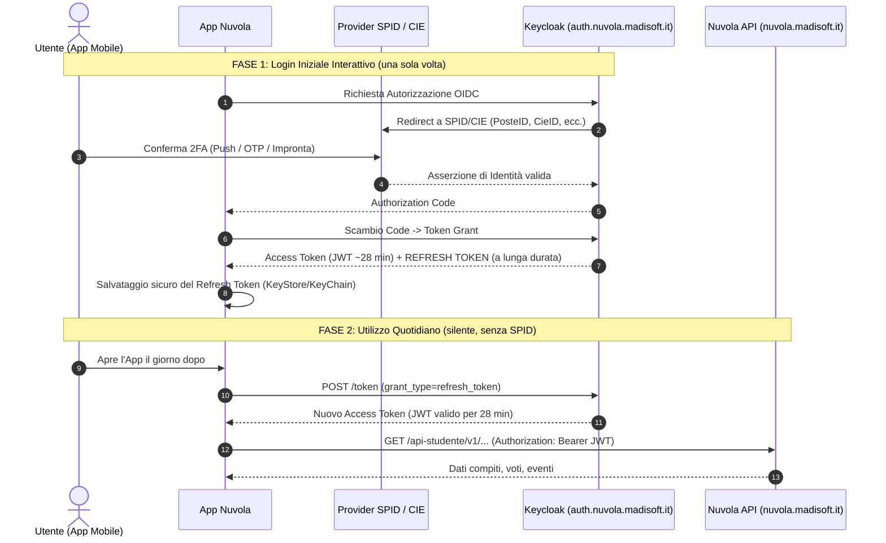

# Analisi di Fattibilità: Integrazione Registro Elettronico Nuvola (Madisoft)

Questo documento analizza la fattibilità tecnica di utilizzare il registro elettronico **Nuvola di Madisoft S.p.A.** come alternativa o opzione configurabile rispetto a **ClasseViva (Spaggiari)** all'interno del progetto **kindleCalendar**.

---

## 1. Sintesi e Risposta Diretta

> **Esito della verifica:** **SÌ, è pienamente fattibile.**

Nuvola Madisoft non offre un'API pubblica documentata per sviluppatori di terze parti, ma la sua applicazione web e mobile si appoggia su una **suite completa di API REST JSON** (`/api-studente/v1/...`). 

Queste API sono state analizzate, reverse-ingegnerizzate e implementate con successo da diversi progetti open-source (tra cui librerie Python su PyPI e componenti per Home Assistant aggiornati al 2026). I dati necessari per la dashboard e-ink (compiti per casa, verifiche, materie, date e descrizioni) sono interamente disponibili.

---

## 2. Dati Richiesti da kindleCalendar e Corrispondenza Nuvola

Attualmente, il server estrae da ClasseViva le seguenti informazioni per popolare la colonna destra del Kindle:
- **Materia** (es. Matematica, Italiano)
- **Data di scadenza / svolgimento** (categorizzata in "Oggi", "Domani", o data futura `DD/MM`)
- **Descrizione del compito / evento**
- **Tipologia di evento** (Verifica formale vs Compito ordinario, classificata tramite Groq LLM o regole euristiche)

### Tabella di comparazione dei campi dati:

| Concetto in kindleCalendar | ClasseViva (Spaggiari) | Nuvola (Madisoft) | Disponibilità / Note |
|---|---|---|---|
| **Identificativo Alunno** | `student_id` (da `AuthApi4.php`) | `id` (da `/api-studente/v1/alunni`) | Disponibile, supporta anche famiglie con più studenti |
| **Materia** | `subjectDesc` / `authorName` | `materia` | Disponibile in chiaro |
| **Data Scadenza / Consegna** | `evtDatetimeBegin` | `dataConsegna` o `dataInizio` | Formato standard (`YYYY-MM-DD` o `DD-MM-YYYY`) |
| **Descrizione** | `notes` | `descrizione` / `annotazioni` | Nota: in Nuvola `descrizione` può essere una stringa o una lista di stringhe |
| **Verifiche & Eventi** | `agenda` (con testo note) | `/eventi-classe` e `/compito/elenco/{data}` | Distinzione nativa tra compiti ed eventi/verifiche di classe |
| **Filtro Intelligente LLM** | Groq (`qwen/qwen3.8-27b`) | Invariato | Lo stesso prompt funziona identicamente con il testo restituito da Nuvola |

---

## 3. Architettura delle API di Nuvola Madisoft

### Parametri di Connessione di Base

- **Base URL:** `https://nuvola.madisoft.it`
- **Host Autenticazione (OIDC):** `auth.nuvola.madisoft.it`
- **Prefisso API:** `/api-studente/v1`
- **Formato Risposte:** JSON (solitamente incapsulato nell'oggetto `{"valori": [...]}`)
- **Autenticazione chiamate:** `Authorization: Bearer <jwt_token>` + query string `?contextAlunno=<student_id>`
- **Scadenza Token:** circa 28–30 minuti (perfettamente compatibile con la cache oraria del progetto)

### Flusso di Autenticazione

Nuvola supporta due flussi a seconda della configurazione dell'istituto scolastico:

#### A. Flusso Standard (Sessione Web + Scambio JWT)
1. **Richiesta GET iniziale:**
   ```http
   GET https://nuvola.madisoft.it/login
   ```
   Estrae il token CSRF dall'input HTML: `<input name="_csrf_token" value="..." />`.

2. **Login credenziali:**
   ```http
   POST https://nuvola.madisoft.it/login_check
   Content-Type: application/x-www-form-urlencoded

   _username=<USERNAME>&_password=<PASSWORD>&_csrf_token=<CSRF_TOKEN>
   ```
   Imposta il cookie di sessione `nuvola`.

3. **Scambio con Bearer JWT:**
   ```http
   GET https://nuvola.madisoft.it/api-studente/v1/login-from-web
   Cookie: nuvola=<SESSION_COOKIE>
   ```
   Restituisce un JSON con `{ "token": "eyJhbGci..." }`.

#### B. Flusso Moderno OIDC / Keycloak (in uso in molti istituti dal 2024–2026)
1. Nuvola effettua redirect da `/connect/authentication-service` a `auth.nuvola.madisoft.it` (Keycloak).
2. Viene compilato il form Keycloak con `_username`, `_password` e i parametri effimeri del form (`session_code`, `execution`, `tab_id`).
3. Il callback reindirizza all'area Nuvola e valida la sessione web.
4. Chiamata finale a `/api-studente/v1/login-from-web` per ottenere il JWT.

---

## 4. Endpoint Principali per kindleCalendar

Una volta ottenuto il token Bearer (`jwt_token`):

### 1. Recupero dell'ID Studente
```http
GET https://nuvola.madisoft.it/api-studente/v1/alunni
Authorization: Bearer <jwt_token>
```
**Risposta:**
```json
{
  "valori": [
    {
      "id": 12345,
      "nome": "Mario",
      "cognome": "Rossi",
      "classe": "3A",
      "scuola": "Istituto Esempio"
    }
  ]
}
```

### 2. Recupero dei Compiti per una Data
```http
GET https://nuvola.madisoft.it/api-studente/v1/alunno/12345/compito/elenco/10-03-2026?contextAlunno=12345
Authorization: Bearer <jwt_token>
```
**Risposta:**
```json
{
  "valori": [
    {
      "id": 7001,
      "materia": "MATEMATICA",
      "descrizione": ["Esercizi pag. 140 n. 1, 2, 3", "Rivedere formule triangoli"],
      "dataConsegna": "2026-03-10",
      "docente": "Prof. Bianchi"
    }
  ]
}
```

> **Nota di parsing:** il campo `descrizione` può essere una stringa oppure un array di stringhe. In Python si gestisce con:
> `descrizione = " ".join(item["descrizione"]) if isinstance(item["descrizione"], list) else str(item["descrizione"])`

### 3. Recupero degli Eventi e Verifiche di Classe
```http
GET https://nuvola.madisoft.it/api-studente/v1/alunno/12345/eventi-classe?contextAlunno=12345
Authorization: Bearer <jwt_token>
```
**Risposta:**
```json
{
  "valori": [
    {
      "id": 8001,
      "tipo": "verifica",
      "nome": "Verifica scritta di Storia",
      "descrizione": "Capitoli 4 e 5",
      "docente": "Prof.ssa Verdi",
      "dataInizio": "2026-03-12 09:00:00",
      "dataFine": "2026-03-12 10:00:00"
    }
  ]
}
```

---

## 5. Progetti e Riferimenti Open Source Esistenti

Esistono già implementazioni mature a cui fare riferimento per dettagli o codice riutilizzabile:

1. **`dddevid/Volta` (GitHub):**
   - Client mobile non ufficiale in Flutter per Nuvola Madisoft.
   - Contiene il file `NUVOLA_API.md` (aggiornato a **marzo 2026**) con tutte le specifiche complete degli endpoint reverse-engineered.
2. **`damjj/ha-nuvola` (GitHub):**
   - Integrazione custom per **Home Assistant** in Python (`custom_components/nuvola/api.py`).
   - Implementa il supporto al flusso di autenticazione OIDC Keycloak (`auth.nuvola.madisoft.it`), gestione sessione aiohttp, rinnovo automatico del token scaduto, scaricamento bacheca e compiti.
3. **`topongo/nuvola` (PyPI / GitHub):**
   - Libreria Python standalone (`pip install nuvola`) che implementa un client orientato agli oggetti per l'API studente di Nuvola Madisoft.
4. **`giorgiobeggiora/nuvola-notifiche` e `hex0x0000/NuvolaBot`:**
   - Bot e script per notifiche e monitoraggio dei compiti su Nuvola.

---

## 6. Valutazione di Impatto e Architettura per kindleCalendar

Qualora si decida di implementare Nuvola, la modifica all'architettura di `kindleCalendar` sarebbe molto pulita e modulare:

### Pattern ad Adattatore / Provider nel `server.py`
Invece di avere solo `get_classeviva_agenda(env)`, si può creare un'astrazione generica:
```
           +-----------------------------+
           |     kindleCalendar Server   |
           +--------------+--------------+
                          |
              +-----------+-----------+
              |                       |
    [Provider ClasseViva]     [Provider Nuvola]
              |                       |
              v                       v
     ClasseViva Spaggiari      Nuvola Madisoft
              |                       |
              +-----------+-----------+
                          |
                          v
         [Filtro Groq LLM / Regole Euristiche]
                          |
                          v
              [Render Template HTML]
```

### Configurazione d'Ambiente (`.env`)
Si possono supportare entrambi i sistemi permettendo la selezione automatica o esplicita:
```env
# Registro Elettronico (opzioni: classeviva, nuvola, none)
REGISTRO_PROVIDER=nuvola

# Credenziali Nuvola Madisoft
NUVOLA_USERNAME=tuo_username
NUVOLA_PASSWORD=tua_password
NUVOLA_STUDENT_ID=        # Opzionale: obbligatorio solo se l'account ha più figli
```

### Strategia di Caching
- Come per ClasseViva, una cache su file locale (es. `/tmp/nuvola_cache.json`) valida 1 ora (3600s) azzera il carico sui server Madisoft ed elimina qualsiasi rischio di ban dell'account o rate-limiting.

---

## 7. Gestione SPID / CIE Obbligatorio e Persistenza della Sessione

Se l'istituto scolastico ha reso obbligatorio l'accesso con **SPID o CIE**, il login automatizzato da script tramite username e password tradizionali per l'account tutore non può effettuare il primo passaggio (poiché SPID/CIE richiede un'interazione umana 2FA: notifica push su app PosteID/CieID, codice OTP o scansione NFC della tessera).

Tuttavia, **il funzionamento con kindleCalendar rimane pienamente realizzabile**. Di seguito viene spiegato perché e come.

### 7.1 Soluzione Immediata: Account Alunno (Senza SPID)
Per legge (circolari AGID e normativa PA), l'obbligo di SPID e CIE si applica ai **cittadini maggiorenni (Genitori / Tutori)** per la firma di documenti con valore legale, giustifiche di assenza e pagamenti PagoPA.
* Gli **alunni minorenni** per definizione non dispongono di SPID personale.
* Nuvola Madisoft prevede perciò quasi sempre l'assegnazione di credenziali standard (**Username e Password dell'alunno**, o credenziali fornite dalla scuola).
* L'account alunno dispone dei permessi di lettura per:
  - Compiti assegnati (`/compito/elenco/{date}`)
  - Verifiche ed eventi della classe (`/eventi-classe`)
  - Argomenti delle lezioni
  - Voti e materie
* **Se la scuola ha fornito le credenziali all'alunno, è possibile usare direttamente quelle** nel nostro server senza alcuna necessità di gestire SPID o token complessi.

---

### 7.2 Come fa l'App Mobile a Mantenere la Sessione con SPID/CIE?
L'app ufficiale per smartphone (**Nuvola Tutore/Studente**) **NON** chiede l'autenticazione SPID/CIE a ogni apertura.

Il funzionamento tecnico si basa sullo standard **OAuth 2.0 / OpenID Connect (OIDC)** gestito tramite il server Keycloak di Madisoft (`auth.nuvola.madisoft.it`):



1. **SPID/CIE è solo l'Identity Provider (IdP):** viene invocato solo per certificare l'identità la prima volta.
2. **Emissione dei Token:** dopo il login, Keycloak emette:
   - un **Access Token (JWT)** di breve durata (~28–30 minuti).
   - un **Refresh Token** (oppure un identificativo di sessione persistente / cookie `nuvola`) a lunga scadenza (settimane, mesi o con rinnovo a finestra scorrevole).
3. **Persistenza:** l'app conserva il Refresh Token nella memoria sicura del dispositivo (Android KeyStore / iOS KeyChain).
4. **Rinnovo Automatico:** alla scadenza dell'Access Token, l'app chiama l'endpoint di refresh in background inviando il Refresh Token e ottiene un nuovo JWT senza dover richiedere nuovamente l'accesso SPID all'utente.

---

### 7.3 Replicare il Meccanismo dell'App per kindleCalendar
Possiamo adottare la medesima strategia utilizzata dall'app per il nostro server Python:
1. Effettuiamo il login con SPID/CIE **una volta sola**.
2. Estraiamo il **Refresh Token** (o il cookie di sessione permanente `nuvola`).
3. Lo inseriamo nelle variabili del file `.env` di kindleCalendar:
   ```env
   NUVOLA_REFRESH_TOKEN=eyJhbGci...
   # oppure
   NUVOLA_SESSION_COOKIE=s%3A...
   ```
4. Nel codice di `server.py`, quando la cache oraria scade o il token JWT risulta non valido (HTTP 401), lo script esegue automaticamente la richiesta di refresh identica a quella dell'app, rigenerando l'Access Token **senza alcun intervento manuale**.

---

## 8. Guida Operativa allo Sniffing dei Pacchetti

Per scoprire l'endpoint di refresh esatto e il formato del payload usato dall'app ufficiale, possiamo analizzare le chiamate di rete.

### Metodo A: Analisi Rapida via Browser DevTools (PC) — *Consigliato come primo test*
Molto spesso il portale web `nuvola.madisoft.it` adotta un cookie di sessione persistente rinnovabile:
1. Su Chrome o Firefox, aprire gli Strumenti per Sviluppatori (`F12` o `Cmd+Opt+I` su Mac) e posizionarsi sulla scheda **Network** (con spunta su **Preserve log**).
2. Andare su `https://nuvola.madisoft.it/login`, cliccare su "Entra con SPID/CIE" e completare l'autenticazione.
3. Al termine dell'accesso:
   - Esaminare la scheda **Application** -> **Cookies** (`https://nuvola.madisoft.it` e `https://auth.nuvola.madisoft.it`).
   - Individuare i cookie `nuvola`, `KEYCLOAK_IDENTITY`, `KEYCLOAK_SESSION`.
   - Filtrare in Network la chiamata `api-studente/v1/login-from-web` e osservare gli header inviati e il JSON restituito.

---

### Metodo B: Sniffing dell'App Mobile con HTTP Toolkit
Se l'app mobile utilizza un endpoint OIDC dedicato (con `refresh_token`), **HTTP Toolkit** permette di intercettare tutto il traffico HTTPS:

1. **Installazione e Avvio:**
   - Scaricare e avviare [HTTP Toolkit](https://httptoolkit.com/) sul Mac/PC.
2. **Connessione dello Smartphone:**
   - **Dispositivo Android con debug USB (ADB):** HTTP Toolkit riconosce il dispositivo e inietta automaticamente il certificato CA (bypassando i controlli di sicurezza se l'app non ha certificate pinning aggressivo).
   - **In alternativa (qualsiasi telefono):** impostare il proxy manuale Wi-Fi sull'IP del computer alla porta indicata da HTTP Toolkit (es. `8000`) e installare il profilo/certificato CA di HTTP Toolkit seguendo la procedura a schermo.
3. **Cattura delle Richieste:**
   - Aprire l'app Nuvola sul telefono.
   - Eseguire il login con SPID/CIE.
   - In HTTP Toolkit, impostare un filtro per URL contenenti `madisoft` o `nuvola`.
4. **Cosa Cercare nei Log:**
   - La richiesta POST successiva al callback di SPID (tipicamente verso `auth.nuvola.madisoft.it/realms/.../protocol/openid-connect/token` o `nuvola.madisoft.it/connect/token`).
   - La risposta JSON contenente i campi:
     ```json
     {
       "access_token": "...",
       "refresh_token": "...",
       "expires_in": 1800,
       "refresh_expires_in": ...
     }
     ```
   - Riavviare l'app o attendere 30 minuti ed effettuare un'azione (es. aprire la sezione compiti) per vedere la richiesta di **refresh** inviata dall'app (`grant_type=refresh_token`).

Una volta catturato questo pacchetto, avremo tutti i parametri esatti per implementare il rinnovo automatico in Python.

---

## 9. Conclusioni e Prossimi Passi Consigliati

1. **Verificare innanzitutto se l'alunno dispone di un proprio account** (username/password Nuvola studente). Se sì, non serve alcuna procedura con SPID/CIE né sniffing.
2. Se è necessario usare esclusivamente l'account genitore SPID/CIE, procedere con l'ispezione tramite **Browser DevTools** o **HTTP Toolkit** per catturare il `refresh_token` o il cookie di sessione.
3. Implementare il client Python con la logica di refresh automatico, garantendo alla dashboard sul Kindle di funzionare ininterrottamente.

