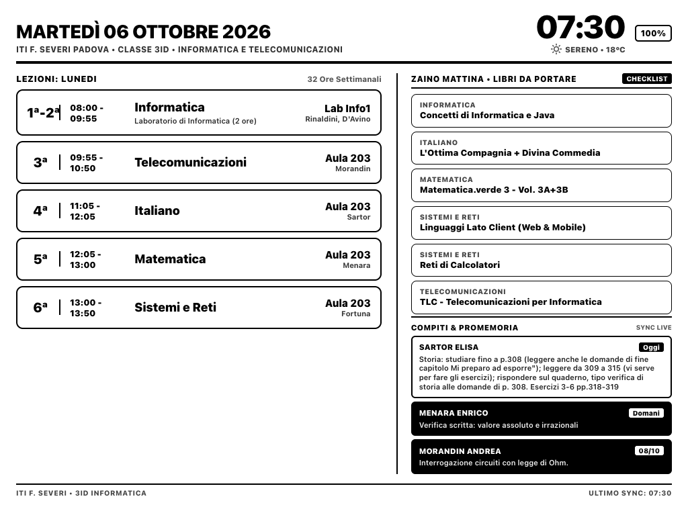
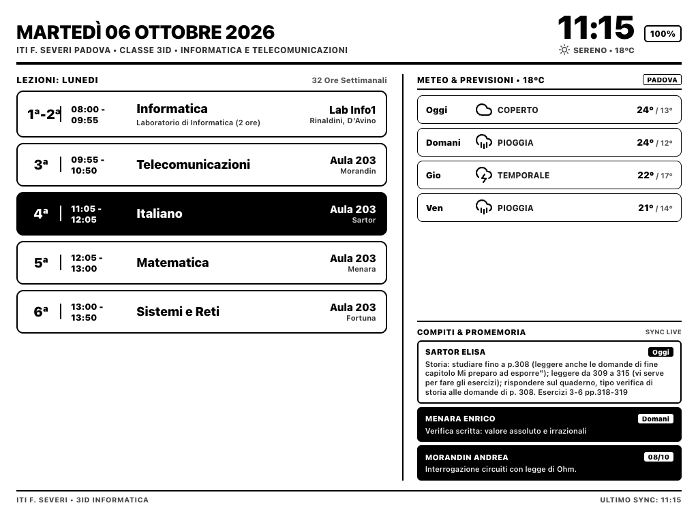
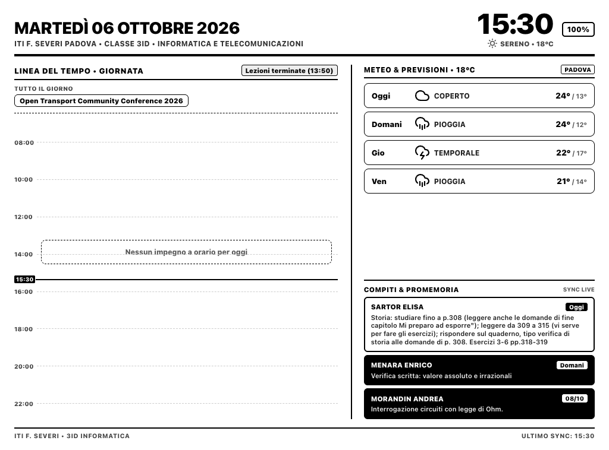
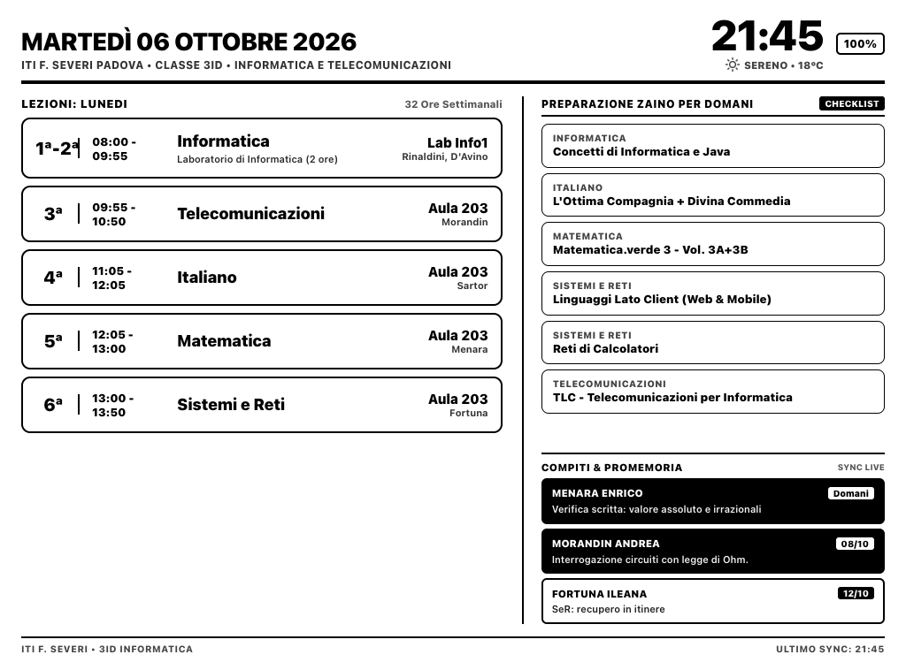
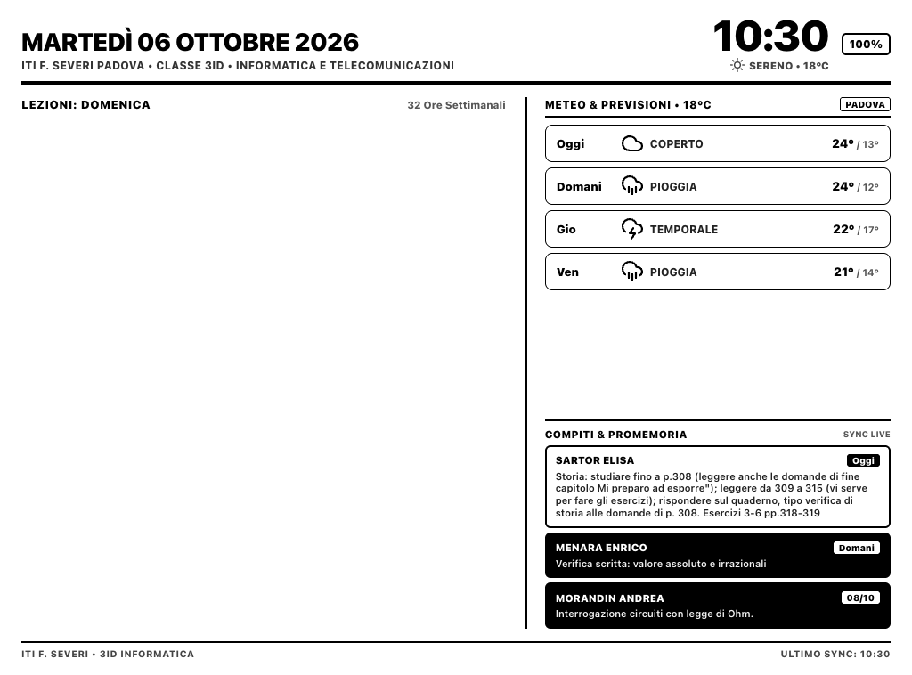
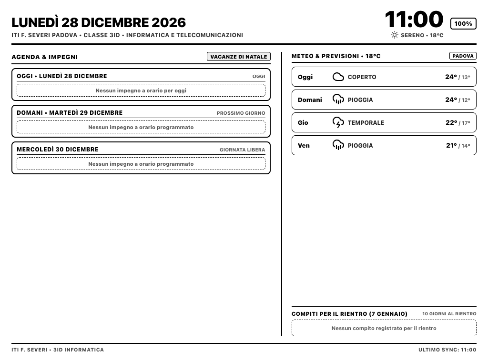

# Scenari e Stati della Dashboard Kindle

Questo documento illustra nel dettaglio i diversi stati operativi e le transizioni temporali della dashboard intelligente per Kindle Paperwhite.

La dashboard adotta una logica dinamica basata sull'orario della giornata, sul calendario scolastico ufficiale (Regione Veneto 2026/2027) e sui feed in tempo reale di Apple iCloud CalDAV e ClasseViva Spaggiari.

---

## Indice degli Scenari
1. [Scenario 1: Mattina Scolastica e Checklist Zaino (07:00 - 08:00)](#1-scenario-mattina-scolastica-e-checklist-zaino-0700---0800)
2. [Scenario 2: Durante le Lezioni Scolastiche (08:00 - Fine Orario + 30m)](#2-scenario-durante-le-lezioni-scolastiche-0800---fine-lezioni--30m)
3. [Scenario 3: Pomeriggio e Linea del Tempo Giornaliera (Dalle 14:20 / Post-Scuola alle 21:30)](#3-scenario-pomeriggio-e-linea-del-tempo-giornaliera-post-scuola---2130)
4. [Scenario 4: Sera e Preparazione Zaino Domani (21:30 - Notte)](#4-scenario-sera-e-preparazione-zaino-domani-2130---notte)
5. [Scenario 5: Fine Settimana e Giorni Liberi (Domenica / Ponti)](#5-scenario-fine-settimana-e-giorni-liberi-domenica--ponti)
6. [Scenario 6: Vacanze Scolastiche Ufficiali (Natale, Carnevale, Pasqua, Estate)](#6-scenario-vacanze-scolastiche-ufficiali-natale-carnevale-pasqua-estate)

---

### 1. Scenario: Mattina Scolastica e Checklist Zaino (07:00 - 08:00)

- **Condizione d'attivazione:** Giorni scolastici (Lunedi - Sabato) prima dell'inizio delle lezioni (tra le 07:00 e le 08:00).
- **Colonna Sinistra:** Orario completo delle lezioni della giornata con dettaglio dei docenti e aule.
- **Colonna Destra (Superiore):** **Zaino Mattina - Libri da portare**. Una checklist ordinata dei libri di testo e materiali didattici specifici per le materie previste nella mattinata.
- **Colonna Destra (Inferiore):** Compiti e promemoria sincronizzati da ClasseViva in ordine cronologico.

---

### 2. Scenario: Durante le Lezioni Scolastiche (08:00 - Fine Lezioni + 30m)

- **Condizione d'attivazione:** Durante l'orario scolastico effettivo e fino a **30 minuti esatti dopo il termine dell'ultima ora** (es. fino alle 14:20 per uscite alle 13:50; fino alle 13:30 per uscite alle 13:00; fino alle 12:35 per il sabato alle 12:05).
- **Colonna Sinistra:** Orario lezioni in corso con indicazione chiara dell'avanzamento.
- **Colonna Destra (Superiore):** Meteo e previsioni a 3 giorni (condizioni attuali, minime/massime, pioggia).
- **Colonna Destra (Inferiore):** Compiti e scadenze ClasseViva.

---

### 3. Scenario: Pomeriggio e Linea del Tempo Giornaliera (Post-Scuola - 21:30)

- **Condizione d'attivazione:** Trascorsi 30 minuti dal termine delle lezioni (es. dalle 14:20) fino alle 21:30.
- **Colonna Sinistra:** **Linea del Tempo Giornata (07:00 - 23:00)** con barra di avanzamento temporale, indicazione di "Lezioni terminate (HH:MM)" ed eventi personali sincronizzati bidirezionalmente da Apple iCloud CalDAV.
- **Colonna Destra (Superiore):** Previsioni meteo complete per oggi, domani e dopodomani.
- **Colonna Destra (Inferiore):** Compiti ClasseViva. **Nota:** Dalle ore **19:00**, i compiti della giornata odierna vengono automaticamente nascosti per focalizzare l'attenzione sulle consegne future (da domani in poi).

---

### 4. Scenario: Sera e Preparazione Zaino Domani (21:30 - Notte)

- **Condizione d'attivazione:** Dalle ore **21:30** nei giorni precedenti a un giorno scolastico.
- **Colonna Sinistra:** Linea del tempo della giornata che riassume gli impegni conclusi e della serata.
- **Colonna Destra (Superiore):** **Preparazione Zaino per Domani**. La checklist si aggiorna automaticamente calcolando le lezioni del giorno seguente e proponendo i libri e i quaderni da preparare la sera prima.
- **Colonna Destra (Inferiore):** Compiti per i giorni successivi in rigoroso ordine cronologico.

---

### 5. Scenario: Fine Settimana e Giorni Liberi (Domenica / Ponti)

- **Condizione d'attivazione:** Domenica, ponti da calendario scolastico regionale (es. ponte dell'Immacolata, 2 Giugno, 25 Aprile, 1 Maggio).
- **Colonna Sinistra:** Vista estesa della Linea del Tempo della giornata con badge "Giorno Libero" / "Domenica".
- **Colonna Destra:** Meteo dettagliato e compiti assegnati per il rientro a scuola.

---

### 6. Scenario: Vacanze Scolastiche Ufficiali (Natale, Carnevale, Pasqua, Estate)

- **Condizione d'attivazione:** Durante i periodi di vacanza riconosciuti (Natale, Carnevale, Pasqua, Vacanze Estive).
- **Layout:** La vista si trasforma rimuovendo completamente la griglia dell'orario scolastico orario.
- **Colonna Sinistra:** **Agenda & Impegni a Card** con gli eventi del calendario personale da iCloud.
- **Colonna Destra (Superiore):** Badge personalizzato del periodo (es. "Vacanze di Natale", "Vacanze Estive") e previsioni meteo estese.
- **Colonna Destra (Inferiore):** Compiti per il rientro a scuola con indicazione della data esatta di ripresa delle lezioni (o compiti estivi).

---

## Specifiche Hardware di Rendering
- **Risoluzione nativa render:** 1024 x 758 px (Landscape)
- **Rotazione Framebuffer Kindle:** 90 gradi senso orario (758 x 1024 px Portrait)
- **Tecnologia di visualizzazione:** Monocromatico ad alto contrasto ottimizzato per e-paper con driver FBInk.
